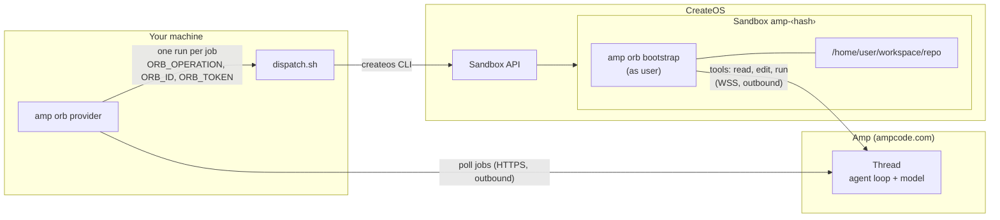
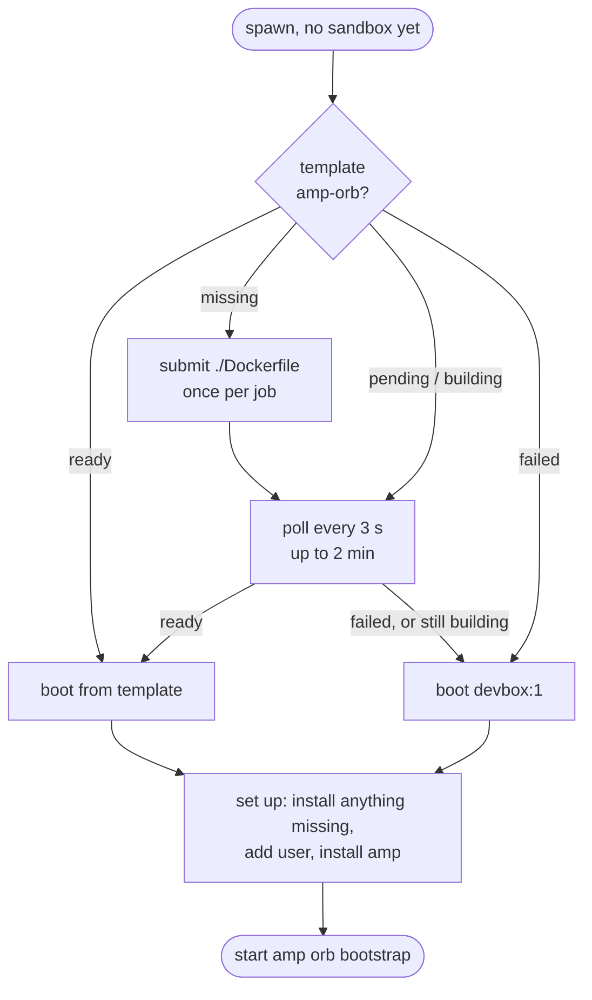
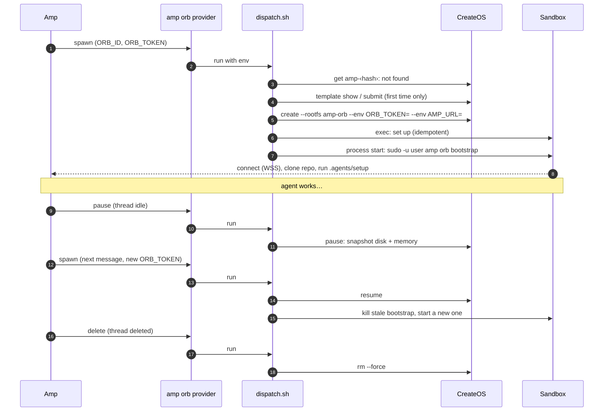
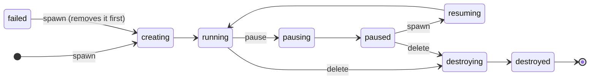

# CreateOS Sandbox for Amp Orbs

Run [Amp](https://ampcode.com) [self-hosted orbs](https://ampcode.com/docs/orbs/self-hosted)
on CreateOS Sandboxes. Each Amp thread gets its own sandbox (a microVM). It
resumes in seconds and costs no compute while paused.

```text
┌─────────────────────────────── At a glance ───────────────────────────────┐
│                                                                           │
│  Amp (ampcode.com)          Your machine                  CreateOS        │
│  ─────────────────          ────────────────              ────────        │
│  thread starts  ─ spawn ─▶  amp orb provider                              │
│  thread idles   ─ pause ─▶         │                                      │
│  thread deleted ─ delete ▶         ▼                                      │
│                              dispatch.sh ─── createos CLI ───▶ sandbox    │
│                                                                  │        │
│  agent tools ◀══════════ amp orb bootstrap (outbound WSS) ═══════╝        │
│                                                                           │
│  one thread = one sandbox  ·  pause keeps disk + memory  ·  no inbound    │
└───────────────────────────────────────────────────────────────────────────┘
```

- [How it works](#how-it-works)
- [Set up](#set-up)
- [The template](#the-template)
- [Lifecycle](#lifecycle)
- [Settings](#settings)
- [How it differs from Amp's examples](#how-it-differs-from-amps-examples)
- [Security](#security)
- [Test](#test)
- [Troubleshoot](#troubleshoot)

## How it works

`amp orb provider` runs on a machine you control. It connects **out** to Amp
and waits for jobs. For each job it runs `dispatch.sh` once. The script drives
the `createos` CLI. Inside the sandbox, `amp orb bootstrap` also connects
**out** to Amp, so Amp can run the agent's tools there. Nothing connects in.



| Amp job  | What `dispatch.sh` does                                                                          |
| -------- | ------------------------------------------------------------------------------------------------ |
| `spawn`  | Resume the sandbox if paused, or create it. Set it up. Start `amp orb bootstrap` as `user`.      |
| `pause`  | `createos sandbox pause`. Disk **and** memory are kept. Compute stops.                           |
| `delete` | `createos sandbox rm --force`. The sandbox and its disk are gone.                                |

Every job is safe to repeat. A job that arrives while an earlier one is still
settling (for example `spawn` while the sandbox is `pausing`) waits for it first.

## Set up

### 1. Prerequisites

On the machine that runs the provider:

| Tool       | Why                                                             |
| ---------- | --------------------------------------------------------------- |
| `amp`      | runs `amp orb provider`                                         |
| `createos` | drives the sandboxes. Run `createos login`, or set `CREATEOS_API_KEY` |
| `jq`       | reads the CLI's JSON output                                     |
| `bash`, `sha256sum` or `shasum` | the script itself                         |

It needs outbound HTTPS to ampcode.com and to the CreateOS API. Nothing else.

### 2. Register a provider in Amp

Open **Settings → Orbs** for your workspace. Click **Add Orb Provider**, name it
(for example `createos`), and copy the `aop_live_…` token. Amp shows it once.

### 3. Run the provider

```sh
chmod +x dispatch.sh
export AMP_ORB_PROVIDER_TOKEN="aop_live_…"
amp orb provider "$PWD/dispatch.sh"
```

Run it under a service manager (systemd, launchd) that restarts it after a reboot.

### 4. Start a thread

```sh
amp -ox "your first message" --orb-provider createos
```

Or, in the Amp thread composer: **Orb** → type dropdown → **Self-Hosted** → `createos`.

## The template

Amp's own orb image can't boot on CreateOS. CreateOS templates may only start
`FROM nodeops/sandbox:debian` or `:alpine`, and they can't `COPY` or `ADD`. So
[`Dockerfile`](./Dockerfile) rebuilds what Amp's
["bring your own image"](https://ampcode.com/docs/orbs/self-hosted#bring-your-own-image)
section asks for, using `RUN` only:

| Amp requirement                                  | Where it comes from                         |
| ------------------------------------------------ | ------------------------------------------- |
| Linux x64, glibc                                 | `nodeops/sandbox:debian` (Debian bookworm)  |
| bash, coreutils, util-linux, CA certificates     | apt                                         |
| git ≥ 2.34                                       | apt (bookworm ships 2.39)                   |
| `amp` at `/usr/local/bin/amp`                    | Amp's installer, which checks a checksum    |
| user `user`, writable `/home/user`, passwordless sudo | `useradd` + `/etc/sudoers.d/user`      |
| Node.js ≥ 18, tmux ≥ 2.9, curl                   | apt                                         |
| ripgrep, gh, openssh-client (recommended)        | apt                                         |
| Desktop (Wayland stack)                          | **left out**                                |

You don't build it yourself. **The first spawn builds it when it is missing:**



The fallback matters. A slow or broken template build never fails the job on
its own. The time is not hard-capped, though: a 2-minute template wait followed
by slow apt or Amp downloads can pass Amp's five-minute limit. Amp then retries
on the next message, and the setup picks up where it stopped. The setup step brings
**any** Debian or Ubuntu rootfs up to the contract. On the template, it finds
nothing missing and does almost nothing.

> [!NOTE]
> Two spawns at the same time can't build twice: CreateOS refuses a second
> template with the same name, and the loser simply polls the winner's build.

> [!WARNING]
> A **failed** template stays failed. The script won't rebuild it on its own,
> because a broken Dockerfile would then use up your template quota on every
> spawn. Read the log, then delete it to retry (use your `CREATEOS_ORB_TEMPLATE`
> name if you set one):
> `createos sandbox template logs amp-orb` and `createos sandbox template rm amp-orb --force`.

## Lifecycle

What a thread does to its sandbox, end to end:



The states a sandbox moves through, and which job moves it:



Jobs that land on a transitional state (`creating`, `pausing`, `resuming`,
`forking`) wait up to 4 minutes for it to settle, then act, or fail if it never
settles. An unexpected state, or a CreateOS API that can't be reached, also
fails the job, so the script never guesses.

## Settings

| Variable                 | Default       | Meaning                                                  |
| ------------------------ | ------------- | -------------------------------------------------------- |
| `CREATEOS_ORB_SHAPE`     | `s-4vcpu-8gb` | Sandbox size. List them with `createos sandbox shapes`.  |
| `CREATEOS_ORB_TEMPLATE`  | `amp-orb`     | Template to boot from, built from `./Dockerfile` if missing. |
| `CREATEOS_API_KEY`       | stored login  | CreateOS credential for the `createos` CLI.              |

Set them in the provider's environment.

## How it differs from Amp's examples

| Amp contract item     | This provider                                                                                  |
| --------------------- | ---------------------------------------------------------------------------------------------- |
| `ORB_IMAGE`           | **Ignored.** CreateOS can't boot it (see [the template](#the-template)).                       |
| `ORB_SNAPSHOT_ID`     | **Ignored**, which the contract allows. Each new thread boots fresh and runs `.agents/setup`.  |
| Machine name = `ORB_ID` | Sandbox names max out at 22 characters, so orb `amp-T-…` becomes `amp-` + 18 hex of `sha256(ORB_ID)`. |
| Pause keeps the disk  | It keeps disk **and** memory. Spawn stops the old bootstrap left from before the pause.        |
| Desktop tab           | Not supported. The template has no Wayland stack.                                              |

## Security

- **No inbound access.** The provider and the orb only connect out.
- **`ORB_TOKEN`** is short-lived (15 minutes, one spawn). It goes to the sandbox as a
  per-process env override, so the sandbox's stored env only ever holds an
  empty placeholder. It does appear on the provider host's process list while
  that one `createos` command runs.
- **`user` has passwordless sudo**, as Amp's contract requires. The sandbox is the
  security boundary, not the account.
- **No egress allowlist.** Orbs need ampcode.com, your Git host, and more.
  CreateOS doesn't enforce hostname egress rules, so a hostname allowlist would
  only look like protection.
- **The `amp` install** pipes Amp's installer to bash. The installer checks the
  binary's SHA-256 before installing it.

## Test

[`test.sh`](./test.sh) runs every job against live CreateOS with a fake
`ORB_TOKEN`. It creates one sandbox and always deletes it, even on failure.

```sh
./test.sh                                # default template, or the devbox:1 fallback
CREATEOS_ORB_TEMPLATE=my-ready-tpl ./test.sh   # force the "template ready" path
```

What it checks:

```text
 jobs on nothing      delete, pause, unknown op ............... exit codes
 API unreachable      delete fails instead of "succeeding" without deleting
 fresh spawn          < 5 min · running · booted from the right rootfs
                      amp, sudo, gh/git/node/tmux/rg/curl, hostname, $HOME
                      token reached bootstrap (Amp answers "rejected")
 repeat spawn         fast · kills a stale bootstrap · passes AMP_URL
 pause / resume       paused · repeat pause · disk kept · memory kept
 races                spawn during "pausing" · pause during "resuming"
                      (each first proves the sandbox really is mid-transition)
 delete               destroying/destroyed · repeat delete
```

The fake token can't run a real Amp thread. For that, register a provider and
start a thread.

## Troubleshoot

| Symptom                                   | Look at                                                                 |
| ----------------------------------------- | ----------------------------------------------------------------------- |
| Orb never starts                          | The provider's log and the thread's setup log (spawn output shows there). |
| `booting devbox:1 instead` in the log     | `createos sandbox template logs <template>` (default `amp-orb`). Delete the failed template to rebuild. |
| `cannot look up sandbox`                  | The CreateOS API was unreachable. The job failed on purpose rather than guess; Amp retries it. |
| `ORB_TOKEN was rejected`                  | The token expired. Amp sends a fresh one with the next spawn.            |
| `sandbox amp-… is <state>; refusing to guess` | `createos sandbox get amp-…`, then fix or delete it by hand.        |
| Template quota error                      | `createos sandbox template ls` and delete unused templates.               |
