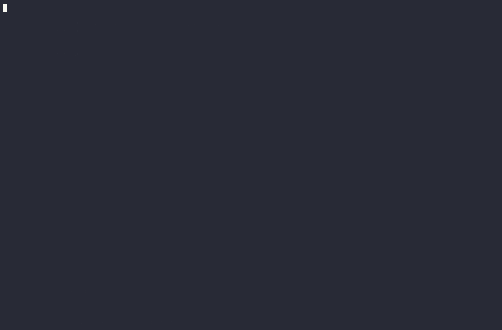
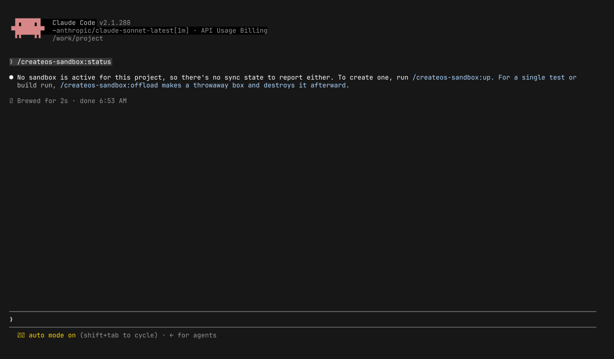
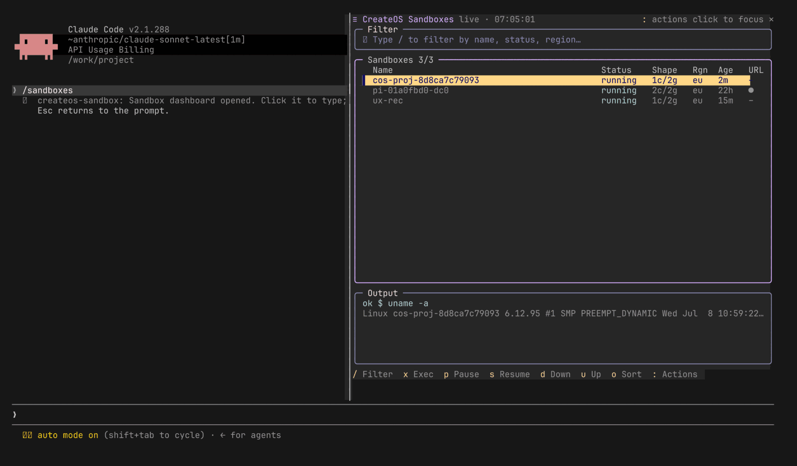

# createos-sandbox user guide

Run heavy, untrusted or ad-hoc code in a throwaway CreateOS box, from inside Claude Code.
This guide shows the common paths and answers common questions. The full reference is the [package README](../README.md).



## Contents

- [Quick start](#quick-start)
- [Which command do I use?](#which-command-do-i-use)
- [Walkthroughs](#walkthroughs)
  - [One-shot offload](#1-one-shot-offload)
  - [Run a snippet with exec](#2-run-a-snippet-with-exec)
  - [Project box: up, run, expose, down](#3-project-box-up-run-expose-down)
  - [The /sandboxes dashboard pane](#4-the-sandboxes-dashboard-pane)
  - [Just ask Claude](#5-just-ask-claude)
- [How your arguments are handled](#how-your-arguments-are-handled-security)
- [Cost and limits](#cost-and-limits)
- [FAQ](#faq)
- [Troubleshooting](#troubleshooting)
- [Known limits](#known-limits)
- [How the media was made](#how-the-media-was-made)

## Quick start

### 1. Install

In Claude Code:

```text
/plugin marketplace add NodeOps-app/createos-plugin
/plugin install createos-sandbox@createos
```

### 2. Sign in to CreateOS

Pick one way. Check it with `cos auth` (see [Requirements](../README.md#requirements)).

```bash
# Option A: browser sign-in, in your own terminal (not through Claude)
createos login            # choose "Sign in with browser"

# Option B: API key. Export it in the shell that starts Claude Code.
export CREATEOS_API_KEY=<your key>
```

Never paste a key into the Claude chat. The chat is saved in a transcript.

### 3. Start Claude Code and read the session-start message

At the start of each session the plugin runs a setup step. It installs or upgrades the `createos` CLI and
checks that you are signed in. Then it tells Claude where the driver (`cos`) is and which command to pick.

You do not see this message on screen. To check that the plugin is loaded, type
`/createos-sandbox:status`. With no box yet, Claude answers that no sandbox is active:



If Claude says "not signed in", sign in (step 2) and start a new session.

### 4. First offload

```text
/createos-sandbox:offload . "echo hello from the box && uname -a"
```

Expect: a box is created, the command runs, the output comes back, the box is destroyed.
You will see `cos: ⚠ egress UNRESTRICTED`. That is normal: by default the box can reach any host.
See [Offload](../README.md#offload--one-shot) for all flags.

## Which command do I use?

```text
                      What do you want to do?
                               |
       +-----------------------+---------------------------+
       |                       |                           |
 Run something once      Keep a box for         Do something special
 (has a finish line)     many commands                     |
       |                       |             +-------------+--------------+
       |                       |             |             |              |
 One file/snippet?       /createos-sandbox:  Graphical   Another      Many boxes
   yes -> exec           up                  screen?     coding agent? at once?
   no  -> a folder?        |                   desktop     agent         fanout
          offload        run / sync / tunnel / expose      (or cluster for
                           |                               boxes on one network)
                         pause  (keep, free)
                         down   (destroy)
```

| I want to... | Use |
| --- | --- |
| Run a test suite or build once, then throw the box away | `offload` |
| Run one untrusted script or snippet | `exec` |
| Split tests over several boxes at the same time | `fanout` |
| Keep a warm box for this repo (dev server, many commands) | `up`, then `run` |
| Stream my local edits into the box | `sync` |
| Open a box port on `127.0.0.1` (private) | `tunnel` |
| Share a box port with a public HTTPS link | `expose` |
| Park the box and stop paying for compute | `pause` (then `resume`) |
| Destroy the box | `down` |
| Let another coding agent work on my code in a box | `agent` |
| A screen with a browser that I can watch | `desktop` |
| An instant Linux terminal | `shell` (run it yourself, see [FAQ](#faq)) |

All commands start with `/createos-sandbox:`. See the [command table](../README.md#command-reference).

## Walkthroughs

### 1. One-shot offload

Use it for a build or test run. The box exists only for the command.

```text
 Your laptop                                   CreateOS box
 -----------                                   ------------
 /createos-sandbox:offload . "npm ci && npm test"
   |  1. pack the folder (skips .git, node_modules, ...)
   |  2. create box ------------------------------> [ new box ]
   |  3. upload the pack -------------------------> [ files ready ]
   |  4. run the command (keeps alive) ----------> [ npm ci && npm test ]
   |  <------------------------------ output ------|
   |  5. -o <dir>: pull results back <-------------| (only if you ask)
   |  6. destroy box -------------------------------> [ gone ]
   v  exit code = the command's exit code
```

```text
/createos-sandbox:offload . "npm ci && npm test"
/createos-sandbox:offload -p python-uv -o dist . "uv sync --frozen && uv run python -m build"
```

What to expect on screen:

- A line `cos: ⚠ egress UNRESTRICTED` unless you set `-p`, `-e` or `-E`.
- For a long job, a `[cos hb HH:MM:SS]` heartbeat line about every 10 seconds. It is normal.
- The command output, then Claude says the box was destroyed.
- Flags go before `<dir> <cmd>`. `-o <dir>` pulls a box folder back. Without it, results are lost with the box.

### 2. Run a snippet with exec

Use it for one source file you do not trust or do not want to run on your laptop.


```text
/createos-sandbox:exec script.py
/createos-sandbox:exec -t 30 -N script.js        # 30 s limit, no network
/createos-sandbox:exec -i input.txt main.go      # feed a file to stdin
```

- Languages: `py js mjs cjs ts go sh rb c cpp rs`. The extension picks the language, or use `-l`.
- Default time limit is 120 s. If it is hit, the exit code is 124.
- `-N` blocks all outbound connections. Without it, egress is unrestricted.
- Output and exit code are the program's own.

### 3. Project box: up, run, expose, down

Use it when work must outlive one command.


```text
   up ----> RUNNING <---- run / sync / tunnel / expose
             |   ^
   pause, or |   | resume (or `up` again)
   30 min    |   |
   idle      v   |
            PAUSED  (files kept, no compute cost)

   down (from RUNNING or PAUSED) ----> DESTROYED (everything is gone)
```

```text
/createos-sandbox:up
/createos-sandbox:run "npm ci"
/createos-sandbox:run "npm run dev &"
/createos-sandbox:expose 3000
/createos-sandbox:down
```

- `up` makes one box per git repo. Run it again and it reuses the same box.
- `run` takes the command as one string. State stays between calls (installed packages, running processes).
- `expose 3000` prints a public HTTPS URL. Anyone with the link can open it. The service must listen on `0.0.0.0`, not `127.0.0.1`.
- `/createos-sandbox:unexpose` revokes the link. `/createos-sandbox:status` shows the active box.
- `down` destroys the box. To keep it, use `/createos-sandbox:pause` and later `/createos-sandbox:resume`.
- After `resume`, run `sync`, `tunnel` and `expose` again.

More: [Project box](../README.md#project-box--live-sessions), [Networking](../README.md#networking).

### 4. The /sandboxes dashboard pane

A live view of your boxes, next to the chat. Needs Claude Code 2.1.287 or newer.




How to use it:

1. Type `/sandboxes`. The pane opens on the right (full-screen layout, 110+ columns) or above the prompt.
   It also opens by itself at session start when your account has any box and the terminal is wide. Close it with the `✕` at its top right.
2. Click the pane with the mouse. Now your keys go to the pane. Esc hands them back to the prompt.
3. Press `j`/`k` to move, `enter` for the action palette, `x` to run a command in the box.
   Backspace in an empty field closes the pane. There are no ctrl shortcuts: Claude Code and your terminal use them.

All keys and notes: [Dashboard pane](../README.md#dashboard-pane-mod).

### 5. Just ask Claude

You do not need a slash command. Say what you want. Claude reads the skill and picks the sandbox.


```text
You:    Run this repo's tests in a CreateOS sandbox and tell me what fails.
Claude: (picks offload) ... runs it ... "The sandbox has been destroyed."

You:    Run this downloaded script, but not on my laptop.
Claude: (picks exec) ...
```

Claude picks by the rule: work with a finish line goes to `offload`, work that must last goes to `up` and `run`.
If the CLI is not signed in, Claude stops and tells you how to sign in. It does not work around it.
See [The skill](../README.md#the-skill).

## How your arguments are handled (security)

When you type `/createos-sandbox:offload . "npm test"`, the text after the command is **data**.
The command file shows it to Claude inside a `<user-arguments>` block. Nothing in it runs on your laptop.
Claude builds one quoted `cos` call. The shell on your laptop sees one quoted string, so `;`, `&&` and `|` inside it are just characters.

```text
You type:   /createos-sandbox:run echo hi; rm -rf ~

Claude runs (one call):   cos run 'echo hi; rm -rf ~'
                                   \_____________________/
                                    one string, sent to the BOX

 laptop:  receives one quoted word. Runs nothing from it.
 box:     runs "echo hi", then "rm -rf ~" inside the throwaway box.
```

So `; rm -rf ~` does nothing on your laptop. In the box it can only touch the box.
`cos` rejects a port for `expose` or `tunnel` that is not a number. See [Safety and scope](../README.md#safety--scope).

## Cost and limits

| Item | What to know |
| --- | --- |
| Default shape | `s-1vcpu-1gb` for `offload` (rootfs `devbox:1`). Pick another with `-s <shape>`. |
| Shapes you can use | `createos sandbox shapes`. An unsupported shape is rejected with an `Allowed: [...]` list. |
| `offload`, `exec`, `fanout`, `shell` | Boxes are destroyed when the work ends. |
| Project box (`up`) | Stays until `down`. Auto-pauses after 30 minutes idle. Change with `up -P 22h` (max `24h`). |
| `pause` | Keeps disk, memory and processes. No compute cost. |
| Running boxes at once | Observed: about 2 on external keys, plus a daily creation cap. These are not published policy. |
| Fanout | `-j N` is the number of boxes at once (default 2). |
| Bandwidth | Each box has 5 GiB for traffic it starts. After that, outbound traffic stops. |

Claude can pick a bigger shape without asking. If you care about cost, say which shape to use.

## FAQ

**Does my code leave my machine?**
Yes, when you offload. The folder you name is packed and uploaded to a CreateOS box. Nothing else is sent.

**What is uploaded and what is left out?**
Big and generated folders (`.git`, `node_modules`, `target`, ...) are skipped. Add more with `-x <glob>`.
See [Uploads and excludes](../README.md#uploads--excludes) for the full list.

**How do I get build output back?**
Use `-o <dir>`. It packs that box folder and pulls it to your laptop. Without `-o`, the box is destroyed with its files.
Example: `/createos-sandbox:offload -o dist . "npm run build"`.

**Is the box deleted if I press Ctrl-C or Escape?**
Yes. In tests, a box was gone within 2 seconds after C-c, and after Escape. No box was left running.

**How do I stop paying for an idle box?**
Run `/createos-sandbox:pause` (keeps state, no compute cost) or `/createos-sandbox:down` (destroys it).
A running idle box is the thing to avoid. The project box also auto-pauses after 30 minutes.

**What is the difference between expose, tunnel and vpn?**

| | Who can reach it | Use it for |
| --- | --- | --- |
| `expose <port>` | Anyone with the HTTPS link | share a preview, receive a webhook |
| `tunnel <remote> [local]` | only you, at `http://127.0.0.1:<port>` | open a box service in your own browser |
| `vpn` | your laptop, on the whole private network | reach many boxes by name. Needs `wg-quick` and `sudo`; run `vpn up` in your own terminal |

**Can I restrict network access?**
Yes. Use `-e <domain>` (repeatable) or `-p <preset>` (`python-uv rust-cargo npm github openrouter openai anthropic cursor`).
`-N` on `exec` blocks all outbound connections. `-E` says "unrestricted" on purpose. The list is allow-only.
See [Egress control](../README.md#egress-control).

**Is egress restriction strong?**
In tests, with only `pypi.org` allowed, `example.com` was blocked over HTTPS and HTTP. The README still says domain rules
take about 30 seconds to apply and are weaker for plain HTTP. For hostile code, prefer IP or CIDR rules.

**Can I use the plugin on a box I made elsewhere?**
The plugin only manages boxes it made (names start with `cos-`) and the box in its state file. Other boxes show in the
dashboard, dimmed with "Made by: another tool". `down` warns before it touches one. To adopt a running box, see `cos up -a`.

**Why does each slash command take a few seconds?**
Claude reads your arguments as data and builds one safe `cos` call. That is one model turn. It is the price of the
[safety rule](#how-your-arguments-are-handled-security).

**How do I run another coding agent in a box?**
Use `agent`. It supports `claude`, `codex`, `opencode`, `pi` and `cursor`:

```text
export OPENROUTER_API_KEY=sk-or-...        # in your shell, before you start Claude Code
/createos-sandbox:agent -m openai/gpt-5.6-luna -o . claude . "fix the failing tests"
```

Use `-o .` or the edits are lost with the box. See [Coding agents](../README.md#coding-agents).

**How do I clean up everything?**
Run these in Claude Code:

```text
/createos-sandbox:unexpose        # revoke the public link
/createos-sandbox:cluster down    # if you made a cluster
/createos-sandbox:down            # stop sync and tunnels, destroy the project box
```

`down` leaves forks alive. To remove them too, run `cos down -f` in your terminal (needs `cos install`).
Then check the dashboard (`/sandboxes`) for boxes you do not need.

**Where do logs and state go?**
Command output prints in the chat. State per project is in `~/.cache/createos-sandbox/<project>.json`
(or `$COS_STATE_DIR`). The CLI install log is `~/.cache/createos-sandbox/install.log`.

**How do I run `cos` in my own terminal?**
Run `scripts/cos install` once, by its full path. It links `cos` into `~/.local/bin`. See [Install](../README.md#install).

**How do I open an interactive shell?**
`shell` takes over the terminal, so Claude cannot run it. Type `!cos shell` in the Claude prompt (after `cos install`).

## Troubleshooting

| Symptom | Cause | Fix |
| --- | --- | --- |
| `cos: not signed in to CreateOS` | No sign-in | `createos login` in your terminal, or export `CREATEOS_API_KEY`; check `cos auth` |
| `createos: command not found` | Auto-install went outside `PATH` | Add `~/.local/bin` to `PATH` |
| `cos: command not found` (in your terminal) | `cos` is not on `PATH` | Run `scripts/cos install` once by full path |
| `/scripts/cos: no such file` | Someone typed `${CLAUDE_PLUGIN_ROOT}` in a Bash command | Do not. Use the path from the session-start message |
| `shape '...' not allowed on your plan` | Shape not on your plan | Pick one from the `Allowed:` list (`createos sandbox shapes`) |
| `insufficient credit; please top up` | Account credit | Top up, then retry. It appeared once on the default shape and went away on retry |
| `no active box`, `cos run` refuses | No project box, or it auto-paused | `/createos-sandbox:up`, or `/createos-sandbox:resume` |
| Build cannot reach a host | You restricted egress | Add `-e <host>` or the right `-p <preset>` |
| Exposed URL gives nothing | Service on `127.0.0.1` | Bind to `0.0.0.0` |
| `stage/boot failed` in fanout | Likely the running-box quota | `/createos-sandbox:down`, or use a lower `-j` |
| `no SSH key found in ~/.ssh/` | `sync` needs a key | Create a key in `~/.ssh/` |
| OOM or out of disk on a small box | Box too small | Use a bigger `-s`. `-w` swap does not work on `devbox:1` |
| `/sandboxes` pane shows "offline" or an error | CLI missing or not signed in | Install or sign in; the pane recovers on its own within about 20 s |
| Browser sign-in never opened | No browser or tmux | Use the fallback URL, or `createos login` in your terminal |

More: [README Troubleshooting](../README.md#troubleshooting).

## Known limits

- `fanout` and `sync` problems: see the `stage/boot failed` and `no SSH key` rows in [Troubleshooting](#troubleshooting).
- **Two checkouts at the same path** get the same box name (`cos-proj-<hash of git root>`), so `up` collides.
  The dashboard picks the first `cos-proj-*` box by name, not always this checkout's box.
- Long jobs print `[cos hb ...]` heartbeat lines, and output may arrive only at the end.

## How the media was made

Recorded with `asciinema` in a CreateOS sandbox running Claude Code with this plugin, rendered to GIF with `agg`.
